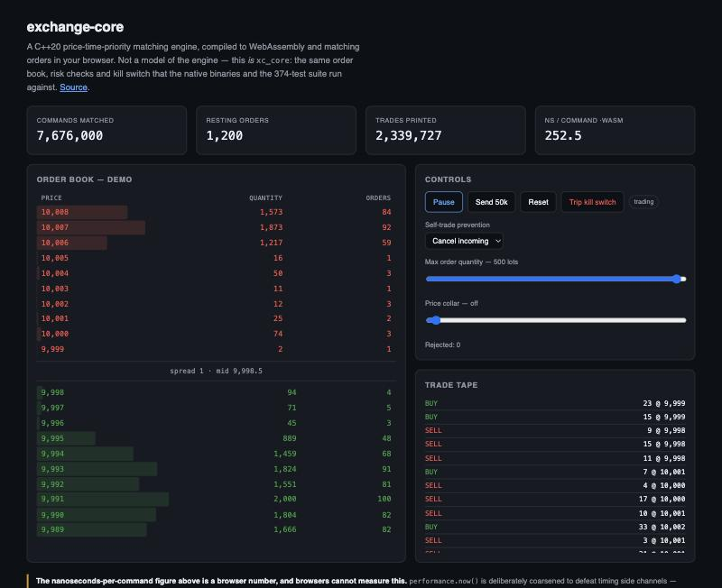

# exchange-core

[](https://github.com/alphasafal/exchange-core/actions/workflows/ci.yml)
[](https://github.com/alphasafal/exchange-core/actions/workflows/bench.yml)
[](https://alphasafal.github.io/exchange-core/)
[](CMakeLists.txt)
[](LICENSE)

A single-node exchange core in C++20: a price-time-priority order book,
pre-trade risk with a kill switch, a write-ahead journal with deterministic
replay, a binary wire protocol, and a TCP/UDP venue simulator.

I built it to learn how a matching engine behaves at the edges: under
adversarial input, after a crash, and in the tail. My rule for the repository is
that every number in it can be regenerated with one command.

**[Try it in your browser](https://alphasafal.github.io/exchange-core/)**: the
same engine compiled to WebAssembly. Trip the kill switch and new orders are
refused while cancels still work ([why](docs/risk.md)).

[](https://alphasafal.github.io/exchange-core/)

## Numbers

In-process matching, one thread, no journal. Apple M2, AppleClang 17,
`-O3 -march=native`. Method and caveats are in
[docs/benchmarks.md](docs/benchmarks.md).

| | |
|---|---|
| Throughput | **13.3 M commands/s**, 75 ns per command |
| Submit latency | p50 83 ns · p99 167 ns · p99.9 333 ns |
| Cancel latency, mixed workload ¹ | p50 42 ns · p99 334 ns · p99.9 916 ns |
| Allocations on the matching path | **0**, enforced by a test |
| Cost vs book depth | 106 ns at 10 price levels, 111 ns at 5,000 |
| Loopback round trip, order to ack | ~16–20 µs, of which matching is ~75 ns |

¹ Two thirds of these cancels target orders that were already filled, so this
row mostly measures rejection. I found this while building the comparison
below. `--live-cancels` measures removal only; see the
[correction](docs/comparison.md#a-correction-to-the-original-benchmark).

The timer on that machine ticks every 41.67 ns, so p50 = 83 ns means two ticks,
not nanosecond precision. That's why throughput is measured in a separate pass
with no clock reads.

### Against Liquibook

The same workload through [Liquibook](https://github.com/enewhuis/liquibook),
an open-source C++ order book, back to back on a cloud VM (Xeon 2.1 GHz,
GCC 13). Median of three runs, live cancels only. Full write-up:
[docs/comparison.md](docs/comparison.md).

| | exchange-core | Liquibook |
|---|---|---|
| Cost per command | **165 ns** | 8,034 ns |
| Submit p50 / p99 | 153 / 397 ns | **137** / 433 ns |
| Cancel p50 / p99 | **123 / 286 ns** | 273 / 95,359 ns |

Submits are a draw. Liquibook is about 10% faster at the median, but it skips
the instrument checks I do (tick, lot, price band, self-trade). Cancels are the
real difference. Liquibook finds an order by walking every order at its price,
so with ~12,000 orders per level its p99 cancel is 95 µs. Mine is an index
lookup, and the cost stays flat. On a book spread thinly across 5,000 prices
the gap shrinks to 239 ns vs 167 ns per command.

## Design decisions

- **Sequence after validation, journal before matching.** A command gets its
  sequence number only after every check that could reject it, and it is
  journaled before it touches the book. So the journal has no gaps, and a
  missing number always means lost data.
- **Flat price ladder instead of `std::map`.** Levels are an array indexed by
  tick, with a bitmap of occupied levels, so finding the best price takes three
  `countr_zero` instructions. This made cost independent of book depth (the
  map rose 27% from 10 to 5,000 levels). The price is a fixed price band per
  instrument ([limitations](docs/limitations.md)).
- **Slab allocation and an intrusive order index.** The first version allocated
  once per order. It went 50,002 → 23,780 → 26 → 0 allocations per 50k orders,
  and a test now fails if one comes back.
- **Durability is honest.** `F_FULLFSYNC` per command costs 2.5 ms (400/s), vs
  264 ns buffered. Plain `fsync` returns sooner but does not survive a
  power cut, so the journal doesn't use it.
- **Open-loop load generation.** A closed-loop harness stalls with the system it
  measures. At 20,000 orders/s that hid most of the tail: p99.9 of 873 µs
  closed-loop against 4.52 ms open-loop.

The first two bullets are written up as decision records, with the options I
rejected and what would change my mind: [docs/adr](docs/adr/). Stage-by-stage detail is
in [docs/architecture.md](docs/architecture.md).



## How I know it's correct

- **Reference model:** a naive O(N²) matcher in `tests/model/` is diffed
  against the real book on random order flow. It found three bugs.
- **Invariants:** the book never crosses, quantity is conserved, and level
  totals match their orders.
- **Fuzzing:** three libFuzzer targets cover the wire decoder, order flow
  against the model, and journal recovery from corrupted segments. Their
  corpora also run as normal tests.
- **Deterministic replay:** replaying the journal reproduces a bit-identical
  state digest, checked by a test.
- **CI on every commit, 12 jobs:**
  - GCC 13 and Clang 18 on Linux, plus Apple Clang
  - each in Release and Debug
  - ASan, UBSan and TSan
  - clang-tidy as errors (it caught a journal filename parser that wrapped an
    index to zero)
  - a fuzz smoke run

  A separate [bench job](.github/workflows/bench.yml) publishes both engines'
  numbers on every push to main.

383 tests in total.

## Build

CMake 3.22+ and a C++20 compiler. Dependencies are fetched by CMake.

```bash
cmake --preset release && cmake --build --preset release -j && ctest --preset release
./scripts/run_bench.sh          # benchmarks with the environment that produced them
./scripts/demo.sh               # start venue, trade, SIGKILL it, replay, verify digest
```

Other presets: `native` (benchmarks), `debug`, `asan`, `ubsan`, `tsan`, `fuzz`.
For the Liquibook comparison, add `-DXC_BENCH_LIQUIBOOK=ON`.

## What it isn't

One node, one matching thread. No authentication, margin, FIX or multi-node
replication. Every number above is from a laptop or a shared VM, so none of them
says anything about a production venue. The full list is in
[docs/limitations.md](docs/limitations.md).

## Docs

[architecture](docs/architecture.md) ·
[decision records](docs/adr/) ·
[benchmarks](docs/benchmarks.md) ·
[comparison](docs/comparison.md) ·
[protocol](docs/protocol.md) ·
[determinism](docs/determinism.md) ·
[risk](docs/risk.md) ·
[failure modes](docs/failure-modes.md) ·
[limitations](docs/limitations.md) ·
[changelog](CHANGELOG.md) ·
[contributing](CONTRIBUTING.md)

MIT licence.
