# exchange-core

[](https://github.com/alphasafal/exchange-core/actions/workflows/ci.yml)

A single-node exchange core in C++20: price-time-priority limit order book,
matching engine, pre-trade risk and kill switch, write-ahead journal with
deterministic replay, a binary wire protocol, and a TCP/UDP exchange simulator.

The engineering goal is not feature count. It is that every claim in this
repository can be reproduced by a stranger with one command, and that the
things which are hard to get right — correctness under adversarial input, crash
recovery, tail latency — are demonstrated rather than asserted.

## Build

Requires CMake 3.22+ and a C++20 compiler. Dependencies are fetched by CMake.

```bash
cmake --preset release
cmake --build --preset release -j
ctest --preset release
```

374 tests. Presets: `release` (portable `-O2`), `native` (tuned to the building
machine, used for benchmarks), `debug`, `asan`, `ubsan`, `tsan` and `fuzz`.

To see exactly what a build was produced with — compiler, version, flags, build
type, whether assertions are on, which sanitizer:

```bash
./build/release/apps/xc_info
```

For the whole thing end to end — venue started, orders matched, the process
killed with `SIGKILL`, journal replayed, state digest verified — run
[`scripts/demo.sh`](scripts/demo.sh). It asserts rather than narrates, and exits
non-zero if anything it claims fails.

## Architecture



The order of those stages is the design. A command is given its sequence number
**after** every gate that could reject it without touching the book and
**before** it is journaled, so journal sequence numbers have no holes in them —
which is what lets a gap mean data loss rather than ambiguity. The journal is
written **before** matching, because a record written afterwards can be lost for
an event the world has already seen.

[docs/architecture.md](docs/architecture.md) covers the path stage by stage, the
data structures and why each was chosen, and the threading model.

## How correctness is established

- **A reference model.** A deliberately naive O(N²) matcher in `tests/model/`
  serves as an executable specification. The optimised book is diffed against it
  on randomised order flow; any divergence is a bug in one of them. Three of
  this project's defects were found that way, each fixed in the commit that
  found it.
- **Property-based invariants.** The book may never cross, quantity is conserved
  across every fill, and level totals must equal the sum of their resting
  orders.
- **Fuzzing.** Three libFuzzer targets in `fuzz/`: the wire decoder on arbitrary
  bytes, order flow diffed against that same reference model, and journal
  recovery over corrupted segments. Their oracles also run as ordinary tests
  over a committed corpus, on both compilers and under the sanitizers — so a
  crash found by a long campaign becomes a regression test by committing one
  file. CI runs 60 s per target, which is a regression gate and not a coverage
  claim.
- **Sanitizers.** AddressSanitizer and UndefinedBehaviorSanitizer over the whole
  suite in CI. ThreadSanitizer has exactly one thing here to look at: the engine
  and the transport are both single-threaded by design, and the only concurrent
  code in the repository is the open-loop benchmark harness, which is what TSan
  checks.
- **clang-tidy**, enforced as errors. It found a journal segment-name parser
  that accepted any filename beginning with `segment-` and digits, so a stray
  `.bak` failed recovery on a healthy journal and `segment--1.xcj` parsed as
  4294967295 and wrapped the writer's next index to zero.
- **Deterministic replay.** Replaying the journal reproduces a bit-identical
  engine state digest. Asserted by a test, not by prose.
- **CI on every commit**: clang-format, GCC 13 and Clang 18 on Linux and Apple
  Clang on macOS, each in Release and Debug, plus ASan, UBSan, TSan, clang-tidy
  and the fuzz smoke run — twelve jobs.

## Measured results

Environment, method and caveats in [docs/benchmarks.md](docs/benchmarks.md);
regenerate with `./scripts/run_bench.sh`. Apple M2, macOS 26.2, AppleClang 17,
`-O3 -march=native`.

| | |
|---|---|
| Matching throughput, in process | **13.3 M commands/s** (75 ns per command) |
| `submit` latency | p50 **83 ns**, p99 **167 ns**, p99.9 **333 ns** |
| `cancel` latency | p50 **42 ns**, p99 **334 ns**, p99.9 **916 ns** |
| Allocations on the matching path | **0** |
| Loopback round trip, order to ack | **~16–20 µs**, of which matching is ~75 ns |

Three caveats that belong beside those numbers rather than in a footnote.

**`steady_clock` on this machine resolves 41.67 ns.** Every individually timed
latency is a multiple of one tick, so a p50 of 83 ns means *two ticks* and not a
nanosecond-accurate measurement. The clock's cost is included and never
subtracted. Throughput is measured in a separate pass with no clock read in the
loop, which is why it is the more trustworthy figure for average cost.

**The zero-allocation claim was false when first measured** — roughly one
allocation per order. `std::unordered_map` allocates a node per insert, so the
order index allocated on every resting order. 50,002 → 23,780 → 26 → 0, with
what fixed each step recorded in the benchmarks document.

**Durability costs what it costs.** `F_FULLFSYNC` on every command is 2.5 ms
(400/s) against 264 ns buffered. Plain `fsync` returns sooner and does not
actually survive a power cut, so using it would have made this number look much
better and the guarantee false.

Latency is reported as p50/p90/p99/p99.9/p99.99/max from a log-linear histogram,
never as a bare average. Load is generated open-loop against intended send
times, because a closed-loop harness stalls with the system it is measuring and
never samples the stall — at 20,000 orders/s that understates p99.9 by **5.2×**
(873 µs against 4.52 ms).

**There is no comparison to any real venue here and none of these figures should
be read as one.** This is a laptop, the wire numbers are loopback, and
[docs/limitations.md](docs/limitations.md) covers what else is not true of it.

## Documentation

| | |
|---|---|
| [limitations.md](docs/limitations.md) | what this is not, and why the numbers are not comparable to production |
| [architecture.md](docs/architecture.md) | the command path, the data structures, the threading model |
| [protocol.md](docs/protocol.md) | the wire format, byte for byte |
| [determinism.md](docs/determinism.md) | what replay guarantees, and what it does not |
| [risk.md](docs/risk.md) | pre-trade limits, collars, rate limiting, kill switch |
| [failure-modes.md](docs/failure-modes.md) | what breaks, how it is detected, which test proves it |
| [benchmarks.md](docs/benchmarks.md) | measured numbers with the environment that produced them |
| [demo.md](docs/demo.md) | the demo storyboard, and how to record it |

## Status

Feature-complete for what it sets out to be, and documented to match. The
components landed in dependency order — order book, matching engine, risk,
journal, protocol, network, measurement, hardening — and every commit builds and
passes CI on both compilers, both platforms and both build types.

What is deliberately absent is in [limitations.md](docs/limitations.md): no
authentication, no multi-node anything, no margin, no FIX. And no recorded
demo — [docs/demo.md](docs/demo.md) is the storyboard and `scripts/demo.sh`
produces the recording, but this repository does not contain one.

## Licence

MIT — see [LICENSE](LICENSE).
